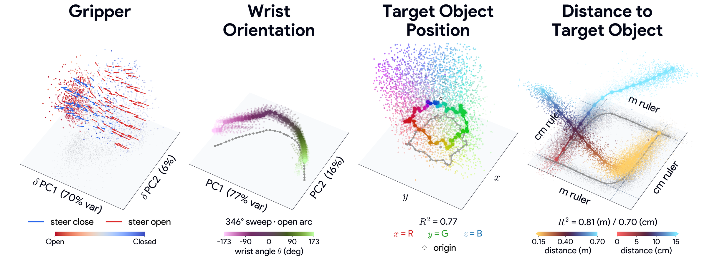

<div align="center">


# A Phenomenology of Neural Geometry in Vision-Language-Action Models

**Code for the simulation experiments: MolmoBot-DROID in the MolmoSpaces simulator**

</div>

---



> **Figure 1. Control variables realize distinct geometries in a VLA policy.** MolmoBot activations
> over many states (clouds) and controlled sweeps varying one physical quantity (traces). Clouds and
> traces are activations projected onto a low-dimensional basis (principal components for the
> gripper and wrist; the span of a linear probe's weights for target position); for distance, the
> activations along the two ruler directions are plotted against the true distance (z axis).
> (**Gripper**) Open and closed states from natural rollouts separate along one axis; arrows show
> interventions reversing the command. (**Wrist**) Rotation sweeps pooled over 64 houses trace an
> open arc, not the circle unconstrained rotation would give. (**Target position**) A structured
> trajectory within the cloud of teleported target placements. (**Distance**) Two orthogonal rulers,
> coarse for approach and fine for grasp.

---

## Abstract

Robotic manipulation is inherently geometric, but what shape does the world take inside the policy
that performs it? Prior work on vision-language-action (VLA) policies establishes that
task-relevant variables are linearly readable from activations, yet readability certifies only that
a variable is present and says nothing about the shape its values trace, which may be curved and
multi-dimensional. Using controlled sweeps, natural rollouts, linear probes, and activation
interventions, we build a taxonomy of seven task-relevant concepts in VLA models. We find that
realized geometry is predominantly multi-dimensional and is shaped by the constraints under which
the policy acts. Physical joint limits, for example, leave wrist orientation an open arc rather than
a circle, and distance to the target, a single scalar, is realized in two orthogonal subspaces, a
coarse ruler for the approach and a fine ruler for the grasp. The same geometries reappear in two
further VLA models on real-world robot data, indicating that they are neither model-specific nor
artifacts of simulation. We demonstrate how the findings are actionable by steering along the
geometry a concept realizes. Overall, this work lays out an initial phenomenology of realized
geometry in VLA policies and demonstrates that a concept's shape carries as much importance as its
readability.

## What is realized geometry?

Interpretability work on VLA policies mostly asks whether a variable can be **read out** from the
activations (probes), or assumes that each concept is a **single direction** (sparse autoencoders).
A probe shows that a variable is present, but not what structure the model gives it: a variable can
be linearly readable and still trace a curved, multi-dimensional shape as its value changes.

The paper separates two things:

| | Question | How this repository measures it |
|---|---|---|
| **Concept realization** | Can information about the concept be extracted under a given readout? | linear probes (ridge, LDA), scored on held-out houses |
| **Realized geometry** | What structure do the activations trace as the concept varies? | controlled sweeps in the simulator, readout rank, Procrustes maps, curvature, principal components |

For the wrist and the gripper the experiments also write to the representation, to test whether an
edit acts on what the model believes or on what it commands.

The model studied is **MolmoBot-DROID**: a VLM reads the language instruction and the camera images,
and an action expert reads the robot's proprioceptive state and generates action chunks by flow
matching, cross-attending to the VLM at each layer. It runs in the **MolmoSpaces** simulator, which
provides the ground-truth task variables and lets the experiments intervene on the world in the
middle of a rollout.

## The experiments

The seven concepts fall into three groups: spatial geometry, task structure and action geometry.
Each figure has its own pipeline, whose README describes its data, stages and compute.

| Figure | Concept | Read in | What the pipeline does | Pipeline |
|---|---|---|---|---|
| 1 | gripper, wrist angle, target position, distance | VLM and action expert | the four overview tiles above | [`gripper`](pipelines/gripper/README.md), [`wrist`](pipelines/wrist/README.md), [`target`](pipelines/target/README.md), [`distance`](pipelines/distance/README.md) |
| 2 | end-effector and target-object position | VLM | teleports the arm and the object, fits position probes, and maps world displacements and paths into the probe subspaces | [`position`](pipelines/position/README.md) |
| 3 | distance to the target object | VLM | fits near- and far-range distance probes, erases one probe's directions, and sweeps the near/far cutoff | [`distance`](pipelines/distance/README.md#figure-3-distance-to-the-target-object) |
| 4 | contact | VLM | fits a contact probe on natural rollouts and tests it on early touches and slips made by teleporting the object | [`contact`](pipelines/contact/README.md) |
| 5 | task phase | action expert | fits a reach / grasp / transport / place probe on pick-and-place rollouts and holds the arm still at landmark moments | [`phase`](pipelines/phase/README.md) |
| 6 | wrist orientation | action expert | sweeps the wrist roll joint, trains a circular autoencoder on rotation sweeps, and steers the wrist with it | [`wrist_steer`](pipelines/wrist_steer/README.md) |
| 7 | gripper | action expert | finds steering vectors that flip the gripper command (pullback) and restricts them to their top components | [`gripper_fig7`](pipelines/gripper_fig7/README.md) |

The real-robot analyses of the paper (Figure 8: MolmoBot, π0.5 and MolmoAct2 on DROID) and the
appendix figures are not part of this repository.

---

## How the repository works

Every figure is reproduced by its whole chain, from simulator rollouts to the rendered file:

```
rollouts, sweeps and interventions   GPU + EGL: MolmoSpaces with MolmoBot-DROID
  -> activation harvests             $VLAGEOM_DATA/<pipeline>/
  -> probes and geometry analyses    CPU
  -> panel arrays                    $VLAGEOM_DATA/panels/*.npz
  -> renders                         figures/*.py -> $VLAGEOM_FIGURES
```

Each pipeline is a sequence of numbered stages (`pipelines/<name>/NN_*.py`, each with `--help`).
The shipped lists in `lists/` hold the paper's episodes, houses and cross-validation folds, so every
stage runs on exactly the paper's units. Figure 1 is rendered as one file; Figures 2-7 are
composites assembled by hand, so for these the repository renders the data panels as separate files.

| folder | contents |
|---|---|
| [`vlageom/`](vlageom/README.md) | library code: simulator environment and policy, rollout engine, gripper edits, probes, plot style, and one module per pipeline |
| [`pipelines/`](pipelines/README.md) | one folder per pipeline, each a sequence of numbered stages, with a README per figure |
| [`figures/`](figures/README.md) | render scripts, one per figure |
| [`lists/`](lists/README.md) | the paper's episodes, houses and cross-validation folds |
| [`scripts/`](scripts/README.md) | one-time download of models and assets, shell environment for the harvest stages (EGL, offline model cache), example SLURM job array |
| [`tests/`](tests/README.md) | the expected values and hashes of every figure's CPU outputs, and checks against reference data (GPU canaries, CPU comparisons) |
| `assets/` | the images of this page |

## Installation

Python 3.11 is required (the policy package needs it).

```bash
# analysis, panel and figure stages (CPU)
python3.11 -m venv .venv && source .venv/bin/activate
pip install -e .
pip install torch==2.7.1 --index-url https://download.pytorch.org/whl/cpu   # CPU build of torch
pip install -e ".[analysis]"            # + torch and ripser, for Figures 6 b-d and 7a-b

# rollouts and harvests (GPU), in a separate environment: every package pinned
python3.11 -m venv .venv-sim && source .venv-sim/bin/activate
pip install -r requirements-sim.lock
pip install -e ".[sim]"
```

With uv, for the harvest environment: `uv venv .venv-sim --python 3.11`, then
`uv pip install -r requirements-sim.lock` and `uv pip install -e ".[sim]"`.

Install the repository in editable mode (`-e`) and run the stages from the checkout: the stages
read the shipped lists from `lists/` and, by default, write under `data/` in the checkout. A
non-editable install (`pip install .`) copies only the package, and the stages then stop with an
error that says so. [`scripts/README.md`](scripts/README.md) has the details of the pinned
versions, the extras, the one-time downloads and the EGL setup of the harvest stages.

## Quickstart: reproduce Figure 1

Figure 1 alone takes about 107 H200 GPU-hours (about 400 one-GPU jobs) and about 150 GB of disk,
33 GB of which are the model inputs saved by `--save-captures`, needed only for Figure 7. Run the
GPU lines with `.venv-sim` active (or `PYTHON=.venv-sim/bin/python` for the SLURM script, submitted
from the repository root); the CPU lines run in either environment.

```bash
python scripts/prefetch_assets.py                           # once, with network access (see scripts/README.md)
source scripts/harvest_env.sh                               # before the GPU stages: EGL, offline model cache

python pipelines/gripper/10_harvest_edits.py --task K --save-captures   # GPU, K = 0..151
python pipelines/gripper/20_panel.py

python pipelines/wrist/01_sweep.py --row N                  # GPU, N = 0..63
python pipelines/wrist/02_check_sweeps.py
python pipelines/wrist/03_panel.py

python pipelines/target/10_teleport_harvest.py --shard K    # GPU, K = 0..113
python pipelines/target/30_square_path_harvest.py           # GPU, one job
python pipelines/target/20_pack_store.py
python pipelines/target/40_probe.py
python pipelines/target/50_panel.py

python pipelines/distance/10_near_harvest.py --shard K      # GPU, K = 0..74
python pipelines/distance/20_pack_near.py
python pipelines/distance/30_ruler_probes.py
python pipelines/distance/40_panel.py

python figures/fig1.py
```

Run each GPU line as one job per unit (`K` or `N`), for example with
`sbatch --array=0-151 scripts/harvest_array.sbatch pipelines/gripper/10_harvest_edits.py --save-captures`;
the other lines run on the CPU. Then:

- Figure 1 comes first: Figure 3 reads its two packed stores, Figure 6a one of its wrist sweeps and
  Figure 7 its gripper edits with the model inputs saved by `--save-captures`. Figures 2, 4 and 5
  are independent of the others; Figure 5 needs `pipelines/phase/05_prepare_assets.py` once.
- The main settings are environment variables:

  | variable | default | meaning |
  |---|---|---|
  | `VLAGEOM_DATA` | `<repo>/data` | root of all harvested data, intermediate arrays and panel files |
  | `VLAGEOM_CHECKPOINT` | `~/checkpoints/MolmoBot-DROID` | policy checkpoint directory (or Hugging Face repo id) |
  | `VLAGEOM_FIGURES` | `<data root>/figures` | rendered figures |
  | `VLAGEOM_FONT_DIR` | unset | directory with the figure font files (Product Sans; DejaVu Sans without it) |

- All GPU stages together take about 450 H200 GPU-hours (about 210 of them for Figure 7's edit
  refits) and 1.2 TB of disk, plus the 20 GB checkpoint and the MolmoSpaces asset cache.

The order of the stages, the full list of environment variables, the compute per figure and the
notes on reproducibility are in [`pipelines/README.md`](pipelines/README.md).

## Checks

`tests/check_expected.py` compares the CPU outputs of every figure (panel files, intermediate
results, probe scores and the rendered files) with the values and hashes recorded in
`tests/expected_fig<N>.json`, without any reference data:

```bash
python tests/check_expected.py                 # Figures 1-7
python tests/check_expected.py --fig 2 5       # selected figures
python tests/check_expected.py --skip-render   # without the renders (no fonts needed)
```

[`tests/README.md`](tests/README.md) lists the other checks: one GPU canary per harvest stage (one
house, episode or task, compared row for row with a reference store), the CPU comparisons with
reference files, and an end-to-end check of each figure's CPU stages.

---

## Authors

**Mozes Jacobs** · **Aiden Swann** · **Mathilde Papillon** *(equal contribution)*

Siddharth Boppana · Fenil R. Doshi · Usha Bhalla · Thomas Icard · Matt Feiszli · Thomas McGrath ·
Vasudev Shyam · Demba Ba · Leon Bergen · Nina Miolane · Owen Lewis · Jack Merullo ·
Ekdeep Singh Lubana · Atticus Geiger

**Matthew Kowal** · **Thomas Fel** *(equal senior contribution)*


Goodfire &nbsp;·&nbsp; Harvard University &nbsp;·&nbsp; Stanford University &nbsp;·&nbsp; University of California, Santa Barbara

## Citation

```bibtex
@article{jacobs2026phenomenology,
  title   = {A Phenomenology of Neural Geometry in Vision-Language-Action Models},
  author  = {Jacobs, Mozes and Swann, Aiden and Papillon, Mathilde and Boppana, Siddharth and
             Doshi, Fenil R. and Bhalla, Usha and Icard, Thomas and Feiszli, Matt and McGrath, Thomas and
             Shyam, Vasudev and Ba, Demba and Bergen, Leon and Miolane, Nina and Lewis, Owen and
             Merullo, Jack and Lubana, Ekdeep Singh and Geiger, Atticus and Kowal, Matthew and Fel, Thomas},
  journal = {arXiv preprint},
  year    = {2026},
  url     = {https://github.com/goodfire-ai/vla-geometry}
}
```

## Credits

- Builds on code by Siddharth Boppana (simulator environment, rollout and activation-capture
  code).
- The plot style (`vlageom/plot/style.py`) is Thomas Fel's house style.
- Figure 6 b-d steering code by Mathilde Papillon: the circular autoencoder chart and the steering runs
  (`pipelines/wrist_steer/50_train_chart.py`, `60_steer.py`, `20_natural_cloud.py`,
  `40_operator.py` and the chart and steering parts of `vlageom/wrist_steer.py`) are adapted from
  her code.
- MolmoSpaces ([allenai/molmospaces](https://github.com/allenai/molmospaces)) and MolmoBot
  ([allenai/MolmoBot](https://github.com/allenai/MolmoBot)) are used as pinned dependencies; both
  are licensed under the Apache License 2.0, as are MuJoCo, the MolmoBot-DROID checkpoint
  (`allenai/MolmoBot-DROID`) and the Qwen3 tokenizer (`Qwen/Qwen3-4B-Instruct-2507`), which are
  downloaded, not shipped. The MolmoSpaces assets (scenes, objects, grasps) are downloaded under
  their own terms.

## License

The code in this repository is released under the MIT License (`LICENSE`).
